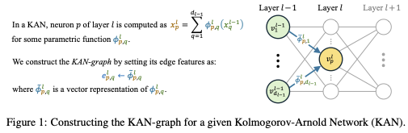

# KAN-Graph-Metanetwork Official Repository


This repository contains the original implementation of *[A Graph Meta-Network for Learning on Kolmogorov-Arnold Networks](https://arxiv.org/abs/2602.16316)* (ICLR 2026).

# Overview:

We introduce a graph based meta network that represents a KAN model as a graph and applies a Graph Neural Network (GNN) to analyze or predict properties of the model from its parameters. This enables tasks such as estimating network performance, pruning, and other forms of model analysis.



⭐ If you find our implementation and paper helpful, please consider citing our work ⭐ :


```bibtex
@article{bar2026graph,
  title={A Graph Meta-Network for Learning on Kolmogorov-Arnold Networks},
  author={Bar-Shalom, Guy and Tavory, Ami and Evron, Itay and Bechler-Speicher, Maya and Guy, Ido and Maron, Haggai},
  journal={arXiv preprint arXiv:2602.16316},
  year={2026}
}
```


# Table of Contents

- [Installation](#installation)
# [Sine Wave Experiment](#sine-wave-experiment)

# Installation

```bash
conda env create -f env.yaml
conda activate KAN-Graph-Metanetwork
```

# Sine Wave Experiment

